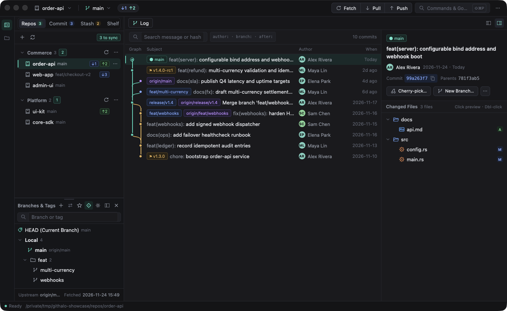
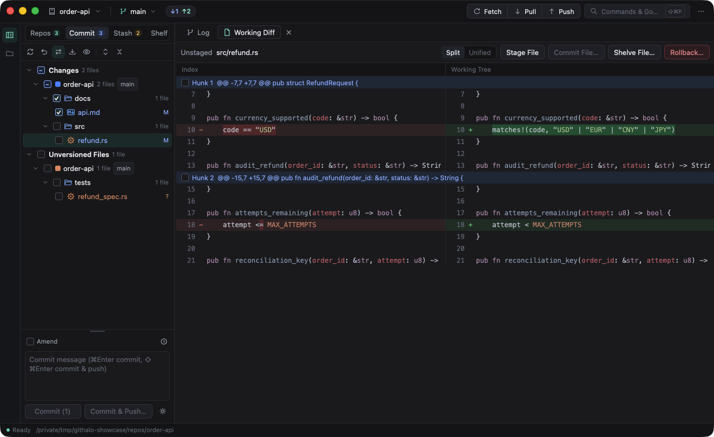
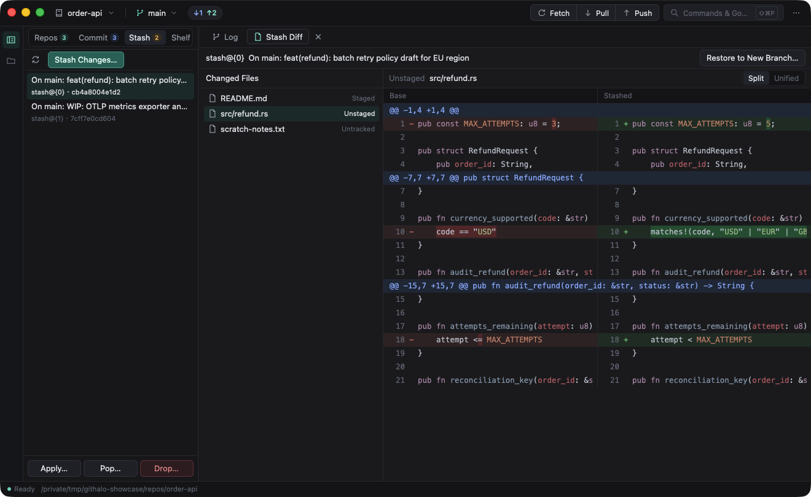

<p align="center">
  
</p>

<h1 align="center">GitHalo</h1>

<p align="center">
  <strong>A fast, native desktop Git client built with Rust and GPUI.</strong><br />
  Complete JetBrains-style Git workflows paired with a multi-repo grouped sync dashboard — without JVM or Electron overhead.
</p>

<p align="center">
  <strong>English</strong> · <a href="README_ZH.md">简体中文</a>
</p>

<p align="center">
  
  
  
  
  
</p>

---

<p align="center">
  
</p>

## Why GitHalo?

Modern developers rarely work on a single repository. Between microservices, frontend/backend splits, shared libraries, and multiple `git worktree` checkouts, choosing a desktop Git client usually forces an uncomfortable trade-off:

- **JVM & Electron clients** offer rich visuals, yet consume hundreds of megabytes to gigabytes of RAM and lag when switching across many repositories.
- **Lightweight open-source GUIs** stay minimal, but drop out when you need interactive rebase, a built-in 3-way conflict editor, hunk-level partial commits, or an independent patch shelf.
- **Fast native clients** are largely closed-source and locked behind paid subscriptions.

**GitHalo** bridges that gap: an open-source, GPU-accelerated native desktop client written from scratch in **Rust + GPUI** (the same rendering engine powering [Zed](https://github.com/zed-industries/zed)), combining a **multi-repo sync cockpit** with **full professional Git workflows** and **100% native Git CLI compatibility**.

### At a Glance

| Capability | GitHalo | Rebased / IntelliJ Git | GitKraken | Fork / Sublime Merge | GitHub Desktop |
| --- | :---: | :---: | :---: | :---: | :---: |
| **Open Source & Free** | Apache-2.0 | Apache-2.0 | Proprietary | Proprietary | MIT |
| **Engine & Rendering** | **Rust + GPUI (GPU)** | JVM | Electron | Native / C++ | Electron |
| **Multi-Repo Grouped Sync Board (`↓ / ↑`)** | **Built-in** | Single project | Favorites | Tabs | Single repo |
| **Async Nested Repo Discovery & Sub-Tree** | **Built-in** | Flat roots | None | None | None |
| **Drag-and-Drop Folder & Group Import** | **Built-in** | Manual | Basic | Basic | Basic |
| **First-Class Git Worktrees** | **Full** | Full | Limited | Limited | None |
| **Hunk Staging & Partial Hunk Commit** | **Full** | Full | Pro | Full | Line-level |
| **Interactive Rebase & 3-Way Resolver** | **Full** | Full | Pro | Full | None |
| **Independent Patch Shelf (Non-Stash)** | **Full** | Full | None | None | None |
| **Side-by-Side Word-Level Diff** | **Full** | Full | Full | Full | Basic |
| **Native Git CLI (Hooks / SSH / GPG)** | **100% Native** | Native | libgit2 | Native | Native |
| **Bilingual UI (English & Chinese)** | **Built-in** | Plugin | English | English | English |

---

## Core Highlights

### 1. Multi-Repo Sync Cockpit, Nested Sub-Repos & First-Class Worktrees
- **Business-Oriented Repo Groups & Drag-and-Drop**: Organize repositories into custom groups (one repo can belong to multiple groups with shared live state). Drag single or multiple local folders straight from Finder onto any group (or onto the empty list area), drag rows between groups in-app, and see live totals even when collapsed.
- **Async Nested Repository Discovery & Collapsible Sub-Trees**: Add a parent repo that contains dozens of nested service repos underneath — GitHalo adds the parent immediately with zero wait, then runs a pruned, low-priority background scan (skipping `node_modules`, `target`, symlinks, and stopping at `.git` roots). Adopt discovered sub-repos via a clean checklist modal either as a **collapsible sub-tree under the parent** (double-click the parent row or click its count pill to toggle, with aggregated sync badges & one-click `Fetch Repo & All Nested`) or into a new group. Every sub-repo gets 100% first-class Git capabilities.
- **Smart Container Folder Import**: Drop a plain non-Git parent folder containing multiple Git repositories — GitHalo automatically scans it in the background and offers one-click grouped import by folder name.
- **Zero-Noise Live Sync Status & Sidebar Badges**: Every row surfaces compact color-coded `↓ behind` / `↑ ahead` pills only when diverged (eliminating `0 / 0` noise), while the segmented sidebar tabs (`Repos` / `Commit` / `Stash` / `Shelf`) display real-time status counts backed by stale-while-revalidate silent window-focus refresh.
- **Concurrent, Fault-Isolated Refresh**: Fetch a single repository, a parent with all its nested sub-repos, or an entire group in the background with concurrency limiting and request deduplication. Offline or HTTP 401 repositories never block healthy ones and can be retried individually.
- **Snapshot-Verified Async Ownership**: Every background read/write is bound to its originating worktree, branch, and upstream. Switching repositories or branches mid-flight never leaks stale results or overwrites another workspace's draft.
- **Native Git Worktrees Manager**: List, create (with optional new branch + auto-registration), lock/unlock, remove (with main worktree protection), and prune linked worktrees directly from the top bar. Linked worktrees appear independently and automatically recalculate when shared tracking refs update.

### 2. Complete Professional Git Workflows
- **Rebased-Style Tri-State Commit Tree & Precision Staging**: Check files, compacted directories, or groups directly to atomically stage/unstage (with partial-hunk indeterminate `−` state), switch between Changes/Unversioned tree and classic Staged/Unstaged dual view, use the 7-action toolbar, right-click to add to `.gitignore` / rollback / shelve / open in editor, resize the commit box, pick from commit message history, and commit instantly via `⌘Enter` (with optional review dialog, `-s` Signed-off-by, `--no-verify`, and Conventional Commit prefixes).
- **Dual-Mode Branches & Tags Tree (Sidebar Drawer + `⌘B` Standalone Column)**: Browse `HEAD`, `Local`, `Remote`, and `Tags` either inside the **resizable bottom sidebar drawer** (enabled by default for a clean 3-column layout) or expanded as a **standalone Log side column (`⌘B`)**. Features `/` directory grouping, favorites pinning, real-time filtering, click-to-filter or navigate Log history, and full branch context actions (checkout remote tracking branch, Checkout & Rebase, Compare, Diff with Working Tree, rename `F2`, delete).
- **Command Palette & Fast Repository Switcher (`⇧⌘P`)**: Run high-frequency Git commands, toggle panels/diff modes, or jump directly to any registered repository from anywhere without leaving the keyboard.
- **Interactive Rebase & Guided Recovery**: Visual Interactive Rebase (`Pick`, `Reword`, `Squash`, `Fixup`, `Drop`, reorder) plus standard Rebase (`--autostash`). Mid-operation conflict banners persist across restarts with `Continue`, `Skip`, and confirmed `Abort`.
- **Built-In 3-Way Conflict Resolver**: Inspect `Base`, `Yours`, and `Theirs` with operation-aware labels (Merge, Rebase, Cherry-pick, Revert), accept either or both sides, or edit the merged result directly in the built-in multi-line editor before staging.
- **Merge, Cherry-Pick, Reset & Revert**: Merge with fast-forward / `--no-ff` / `--ff-only` / `--squash`, Cherry-pick with `-x` and merge parent `-m`, Undo Commit (`--soft HEAD^`), Reset (`Soft` / `Mixed` / `Hard` / `Keep`), and Revert with full conflict recovery.
- **Dual Shelving — Stash & Independent Shelf**:
  - **Stash**: Inspect staged, unstaged, and untracked layers separately with per-file Diffs; Apply, Pop, Drop, or restore from original base into a new branch.
  - **Shelf**: Patch-based shelving stored under `<git-common-dir>/githalo-shelf/` without touching `refs/stash` — selectively shelve files, preview patches, unshelve (keep or remove), and delete.
- **Remotes, Branches & Tags**: Clone, Init, manage multiple Remotes, configure branch upstream tracking (including one-click binding from the sidebar footer), create/push/delete lightweight & annotated Tags, Pull with strategy selection (`--ff-only`, `Merge`, `Rebase --autostash`), safe force push (`--force-with-lease`), and `Push up to commit`.

### 3. Code-Review-Grade Diff, Integrated Code Editor & Deep History Inspection
- **Side-by-Side Syntax-Highlighted Diff**: Powered by `syntect` across Commit Diff, Working Tree Diff, Stash Diff, and Shelf Diff, layering multi-language TextMate syntax colors cleanly with word-level inline diff highlights. Click any changed file for an inline preview below the Commit Summary card, or double-click to open a full-width **Commit Diff** tab and step through files with `← / →`.
- **Integrated Native Code Editor & Git Gutter**: Double-click any project file (with 30+ color-coded vector file icons) to open it directly in an editable GPUI code view featuring `syntect` syntax highlighting (50+ languages including embedded HTML `<style>`/`<script>`), undo/redo, smart indentation, IME input, in-file Find & Replace (`⌘F`/`⌥⌘F`), Go to Line (`⌘G`), Soft-Wrap, bookmarks (`F3`), **inline Git Blame gutter**, and **real-time Git change markers with single-hunk diff preview & undoable rollback**.
- **Smooth Commit Graph, Author Avatars & Structured History Search**: Inspect smooth cubic-bezier branch curves, a double-ring `HEAD` indicator, muted Conventional Commit prefixes, deterministic author initials avatars, and relative timestamps; filter by keywords or structured syntax (`author:`, `branch:`, `after:`, `before:`), and paginate seamlessly beyond the initial 200 commits.
- **File History, Blame & Revision Compare**: Open tabbed **File History / Line-by-Line Blame** right from the Diff header, or mark any commit as a comparison base to diff arbitrary revisions.

### 4. Built for Speed, Safety & Native Desktop Craft
- **Native macOS Craft & Adaptive UI Scaling**: Complete 7-group native macOS application menu bar, unobtrusive status-bar hover previews (no obscuring multi-line tooltips over lists), native HIG arrow cursors, and persisted adaptive UI scaling (`90%`–`130%` via `⌘=` / `⌘-` / `⌘0`).
- **100% Native Git CLI Execution**: Because GitHalo invokes your system `git` binary instead of reimplementing Git via `libgit2`, your existing SSH agents, GPG signing, `pre-commit` / `pre-push` hooks, `.gitconfig` `includeIf` rules, and credential helpers work out of the box.
- **Explicit Confirmation Before Destructive or Remote Actions**: Commits, Pushes (clearly distinguishing fork push targets from pull upstreams), `--force-with-lease`, Hard Reset, and Abort dialogs always show the exact worktree, branch, target remote, and affected files before running.
- **Bilingual Out of the Box**: Automatically follows your OS language (English / Simplified Chinese) and can be switched in Preferences or via `GITHALO_LANG=en|zh`.

---

## Visual Walkthrough

<table>
  <tr>
    <td width="50%">
      <strong>Side-by-Side Word Diff &amp; Hunk Staging</strong><br />
      Inspect inline word-level diffs in Split or Unified mode, stage/commit individual hunks, shelve files, or rollback safely.
      
    </td>
    <td width="50%">
      <strong>Layered Stash Inspection</strong><br />
      Inspect Staged, Unstaged, and Untracked layers separately with side-by-side diffs before Apply, Pop, or Restore to New Branch.
      
    </td>
  </tr>
</table>

---

## Performance

GitHalo is engineered to stay responsive even across large workspaces and 10,000-file change trees (via viewport-virtualized rows and cached diff/tree indices).

### Measured Samples (macOS Apple Silicon)

- **Compact Installer & Native Binary**: **6.6 MiB** compressed `.dmg` installer (**15 MiB** self-contained Mach-O arm64 executable) — no Electron bundle, no JVM runtime.
- **Native Window (Debug build)**: First interactive frame in **232–402 ms**, steady-state RSS **68.7–69.4 MiB** (with loaded worktrees).
- **8-Repository Grouped Workspace (Release data-layer benchmark, warm cache, 3-round median)**:
  - Reopen persisted SQLite registry & groups: **3.1 ms**
  - Expand group to all 8 local `↓ / ↑` counts ready: **463.7 ms**
  - Switch repository to first parsed text Diff: **184.0 ms**
  - Concurrent local bare-remote Fetch across all 8 repos: **860.2 ms**

> Measured on Apple Silicon macOS with Git 2.50.1 and the built-in offline Git test fixture (`client/src/git/fixtures/sync.bundle`).

Reproduce the benchmark locally:

```bash
cd client
cargo test --release --locked --no-default-features --test workspace_flow first_release_timings -- --ignored --nocapture
```

---

## Keyboard Shortcuts

| Shortcut (macOS / Linux & Win) | Action |
| --- | --- |
| `Cmd+Shift+P` / `Ctrl+Shift+P` | Open Command Palette & quick repository switcher |
| `Cmd+K` / `Ctrl+K` | Open Commit panel |
| `Cmd+Shift+K` / `Ctrl+Shift+K` | Open Push confirmation |
| `Cmd+T` / `Ctrl+T` | Open Pull dialog |
| `Cmd+L` / `Ctrl+L` | Focus Commit Log search & filter |
| `Cmd+B` / `Ctrl+B` | Toggle standalone Branches column in Log |
| `Cmd+\` / `Ctrl+\` | Show / hide sidebar |
| `Cmd+1`–`Cmd+5` | Switch between Repos, Commit, Stash, Shelf, and Project Files |
| `Cmd+=` / `Cmd+-` / `Cmd+0` | Zoom UI scale (`90%`–`130%`) / reset to `100%` |
| `←` / `→` | Navigate previous / next file in full-width Commit Diff tab |

---

## Installation & Quick Start

### Prerequisites

- **Git 2.43+** (requires `git fetch --porcelain`, `git show-ref --exists`, and `git merge-file --object-id`)
- **Rust** (stable toolchain with Rust 2024 edition support)
- **macOS**: Xcode Command Line Tools (uses system fonts and runtime-compiled Metal shaders)

### Download Prebuilt Release (macOS)

Download the latest Apple Silicon `.dmg` (~6.6 MiB) directly from the **[GitHub Releases](https://github.com/chobitsX/githalo/releases/latest)** page and drag **GitHalo.app** into `/Applications`.

> **Note for macOS Gatekeeper:** Because initial open-source builds are not yet Apple-notarized, if macOS blocks the first launch, run:
> ```bash
> xattr -dr com.apple.quarantine /Applications/GitHalo.app
> ```

### Build & Run from Source

```bash
git clone https://github.com/chobitsX/githalo.git
cd githalo

# Build and launch the optimized release binary
cargo run --release --manifest-path client/Cargo.toml --locked
```

Useful runtime environment variables:

```bash
# Override UI language ("en" or "zh")
GITHALO_LANG=en ./client/target/release/githalo

# Point to an isolated SQLite workspace database
GITHALO_DB=/tmp/githalo-demo.sqlite3 ./client/target/release/githalo
```

Workspace registrations, group memberships, and fetch history are stored locally in:
- **macOS**: `~/Library/Application Support/githalo/workspace.sqlite3`
- UI preferences live alongside it in `preferences.ini`.

---

## Platform Support & Roadmap

| Platform | Status | Notes |
| --- | --- | --- |
| **macOS (Apple Silicon)** | Verified | Full desktop & 170+ test regression suite verified on Apple Silicon |
| **macOS (Intel)** | Experimental | Builds via GPUI Metal backend; community testing welcome |
| **Linux (Wayland / X11)** | Experimental | Headless core verified in CI; `gpui_platform` Wayland/X11 enabled — PRs welcome |
| **Windows** | Planned | GPUI Windows backend integration & packaging — PRs welcome |

**Upcoming Focus Areas:**
- Light theme & customizable color schemes
- Git Submodules & Git LFS management
- Prebuilt binaries for macOS Intel, Linux, and Windows, plus Homebrew Cask distribution

---

## Contributing

Contributions are warmly welcomed! See [CONTRIBUTING.md](CONTRIBUTING.md) for architecture notes, offline test fixtures, and PR guidelines.

```bash
cd client
cargo fmt --all -- --check
cargo clippy --locked --all-targets -- -D warnings
cargo test --locked
```

---

## Acknowledgments

- **[Zed Industries / GPUI](https://github.com/zed-industries/zed)** for the high-performance Rust GPU UI framework (`Apache-2.0`).
- **[Rebased](https://github.com/DetachHead/rebased)** (`1.1.24`) as the workflow and interaction baseline that inspired GitHalo's clean-room Rust implementation.
- **[Scap](https://github.com/zed-industries/scap)** for the public Git history used in the offline test fixture (`MIT`).

See [NOTICE](NOTICE) for full third-party attribution details.

## License

GitHalo is licensed under the [Apache License, Version 2.0](LICENSE).
