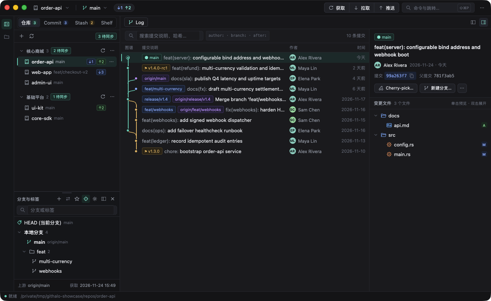
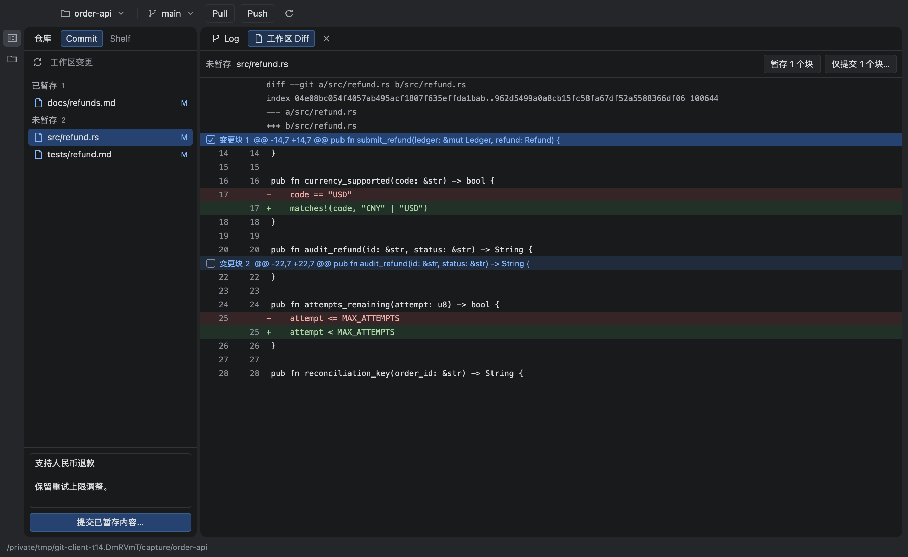

<p align="center">
  
</p>

<h1 align="center">GitHalo</h1>

<p align="center">
  <strong>基于 Rust + GPUI 构建的原生高性能桌面 Git 客户端</strong><br />
  将 JetBrains 级完整 Git 工作流、多仓分组实时同步看板与大文件多变动 Diff 毫秒秒开融于一体，彻底告别 JVM 与 Electron 的资源开销与卡顿。
</p>

<p align="center">
  <a href="README.md">English</a> · <strong>简体中文</strong>
</p>

<p align="center">
  
  
  
  
  
</p>

---

<p align="center">
  
</p>

## 为什么做 GitHalo？

现代研发很少只守着单个仓库——微服务拆分、前后端联调、公共组件库，再加上多个并行开发的 `git worktree`，挑一款趁手的桌面 Git 工具常常要面临尴尬的取舍：

- **JVM / Electron 客户端**：功能丰富，但动辄占用数百 MiB 到数 GiB 内存，冷启动慢，多仓切换掉帧，遇到万行级大文件多变动 Diff 时更是容易直接卡顿甚至假死。
- **轻量开源 GUI**：轻便易用，但在真正需要交互式 Rebase、内置三方冲突编辑器、按变更块局部提交或独立 Shelf 搁置时力不从心。
- **高性能原生客户端**：体验顺滑，但大多闭源且需要付费订阅。

**GitHalo** 希望给出一个干净的解法：以 **Rust + GPUI**（[Zed](https://github.com/zed-industries/zed) 同源 GPU 渲染引擎）从零原生编写、完全开源免费，把**多仓业务分组同步驾驶舱**、**完整专业级 Git 工作流**与 **100% 本机 Git CLI 兼容性**合而为一。

### 核心能力一览

| 维度 | GitHalo | Rebased / IntelliJ Git | GitKraken | Fork / Sublime Merge | GitHub Desktop |
| --- | :---: | :---: | :---: | :---: | :---: |
| **开源免费** | Apache-2.0 | Apache-2.0 | 闭源付费 | 闭源付费 | MIT |
| **底层引擎** | **Rust + GPUI (GPU 加速)** | JVM | Electron | 原生 / C++ | Electron |
| **多仓业务分组与实时同步看板 (`↓ / ↑`)** | **原生内置** | 单项目视角 | 仅收藏夹 | 仅标签页 | 单仓切换 |
| **异步嵌套子仓库发现 & 可折叠子树** | **原生内置** | 仅平铺检测 | 不支持 | 不支持 | 不支持 |
| **拖拽文件夹入组 & 容器目录批量建组** | **原生内置** | 手动添加 | 基础拖拽 | 基础拖拽 | 基础拖拽 |
| **Git Worktrees 一等管理** | **完整支持** | 完整支持 | 有限支持 | 有限支持 | 不支持 |
| **按块暂存与局部提交 (Hunk Commit)** | **完整支持** | 完整支持 | 付费版 | 完整支持 | 按行暂存 |
| **交互式 Rebase & 内置三方解冲突** | **完整支持** | 完整支持 | 付费版 | 完整支持 | 不支持 |
| **独立 Shelf 补丁搁置（不污染 Stash）** | **完整支持** | 完整支持 | 不支持 | 不支持 | 不支持 |
| **大文件多变动并排 Diff** | **毫秒级秒开（~52 ms · 零假死）** | 完整支持 | 易卡顿 | 较快 | 基础对比 |
| **多选提交净变更聚合 & 批量操作** | **完整支持（批量管线）** | 完整支持 | 有限支持 | 完整支持 | 不支持 |
| **本机 Git 兼容（Hooks / SSH / GPG）** | **100% 原生** | 原生 | libgit2 | 原生 | 原生 |
| **原生中 / 英双语** | **自动跟随系统** | 需插件 | 仅英文 | 仅英文 | 仅英文 |

---

## 核心亮点

### 1. 多仓业务分组总览、异步嵌套子仓库 & Git Worktree 一等公民
- **按业务自定义分组 & 丝滑拖拽**：将本地仓库归入不同业务组（同一仓库可跨多组并共享实时状态）。支持直接从访达（Finder）拖入单个或多个文件夹到指定分组（亮起高亮落点并自动展开）或空白处，也支持应用内直接拖动仓库行跨组移动；折叠分组时组头依然清晰汇总待同步数量。
- **异步嵌套子仓库自动发现 & 可折叠子树**：添加包含大量嵌套微服务子仓的父项目时，主仓库零等待即刻可用，后台低优先级剪枝扫描线程（跳过 `node_modules`/`target`/符号链接、命中 `.git` 即止）在毫秒级发现全部子仓库并以轻提示引导纳管。可一键勾选**挂在父仓库下形成可折叠子树**（支持**双击父仓整行**或点击子仓胶囊直接展开/收起，右键支持「刷新主仓及全部子仓库」）或新建独立分组；每个子仓库均享有 100% 与主仓库平权的完整 Git 能力。
- **普通容器文件夹智能批量建组导入**：直接把本身不是 Git 仓库、但内部装着多个 Git 项目的普通目录拖入列表，自动后台扫描并弹窗一键按目录名建组批量导入。
- **零噪音实时同步状态 & 侧栏语义徽章**：仅在存在待同步提交时展示紧凑彩色 `↓ 落后 / ↑ 领先` 胶囊（彻底消除 `0 / 0` 噪音）；顶部四段式页签（`仓库 / Commit / Stash / Shelf`）实时汇总工作区状态计数，并支持切回窗口时的 Stale-While-Revalidate 无感静默刷新。
- **并发可控、故障隔离的后台 Fetch**：支持单仓刷新、父仓及全部子仓联动刷新、整组一键刷新，自动合并重复请求并限制并发；某个仓库断网、HTTP 401 或路径失效时，不影响其他健康仓库继续刷新，并支持逐行单独重试。
- **严格的异步状态归属校验**：每个后台读写任务均绑定发起时的工作树、分支与上游快照。刷新期间切仓或在终端切分支，迟到结果绝不会串仓或污染当前草稿与刷新时间。
- **原生 Git Worktrees 管理**：顶栏直接管理关联工作树——支持列表查看、新建工作树（可同时建新分支并自动登记）、锁定/解锁、移除（保护主工作树）及 Prune 清理；关联工作树各自独立显示状态，并在共享远端引用更新后自动重算。

### 2. 完整的专业级 Git 工作流
- **三态勾选变更树与精准提交（对齐并超越 Rebased）**：支持按「更改 / 未跟踪文件」目录压缩树或经典「已暂存 / 未暂存」双区视图自由切换，文件/目录/分组三态复选框直连 Git Index（局部 Hunk 自动呈现半选态 `−`）；内置 7 键专业工具栏、右键一键添加 `.gitignore` / 回滚 / 搁置 / 编辑器打开、可拖拽提交框高度、提交历史消息下拉、`⌘Enter` 直接提交以及提交选项齿轮（审阅确认、`-s` Signed-off-by、`--no-verify`、Conventional 前缀）。
- **双模式分支与标签树（侧栏底部分支抽屉 + `⌘B` 独立分栏）**：按 `HEAD / Local / Remote / Tags` 分组展示并支持 `/` 目录折叠、星标收藏置顶、实时搜索、点击筛选 Log 或跳转定位；默认在**侧栏底部以可拖拽高度抽屉**呈现（保持清爽三栏黄金比例），按 `⌘B` 即可一键展开为 **Log 左侧独立分栏**，内置完整右键菜单（远端分支检出、Checkout & Rebase、修订对比、与工作树 Diff、`F2` 重命名及安全删除）。
- **命令与仓库快速跳转面板（`⇧⌘P`）**：无需离开键盘即可全局检索执行高频 Git 操作、切换面板/Diff 视图或直达任意已登记仓库。
- **可视化交互式 Rebase 与中断恢复**：支持标准 Rebase（含 `--autostash`）与可视化交互式 Rebase（上下调序、切换 `Pick / Reword / Squash / Fixup / Drop` 与自定义提交说明）；冲突中断后展示进度横幅，重启应用后仍可无缝 `Continue / Skip / Abort`。
- **内置三方冲突解决器**：按操作语义（Merge / Rebase / Cherry-pick / Revert）清晰标注 `Base / Yours / Theirs`，支持一键采用本地、采用传入、保留双方，或使用内置多行合并编辑器手动编辑后直接保存暂存。
- **Merge、Cherry-pick、Reset 与 Revert**：合并支持快进 / `--no-ff` / `--ff-only` / `--squash`；Cherry-pick 支持 `-x` 与合并提交 `-m`；支持 Undo Commit（`--soft HEAD^`）、Reset（`Soft / Mixed / Hard / Keep`）与 Revert（含冲突恢复）。
- **双保险搁置体系：Stash + 独立 Shelf**：
  - **Stash**：按已暂存、未暂存、未跟踪三层分别预览逐文件 Diff，支持 Apply、Pop、单条 Drop 以及从原基点恢复到新分支。
  - **Shelf**：独立补丁存储于 `<git-common-dir>/githalo-shelf/`，完全不触碰 `refs/stash`；支持按文件选择性搁置、Diff 预览、Unshelve（保留或移出）及删除。
- **远端、分支与标签全管理**：Clone、Init、Remotes 管理、分支上游跟踪绑定/解除（支持从侧栏底栏一键绑定）、轻量与附注标签的创建/推送/删除；Pull 支持三段策略切换（`--ff-only` / `Merge` / `Rebase --autostash`）；Push 支持 `--force-with-lease` 安全强推与日志右键「推送至此提交」。

### 3. 万行级大文件 Diff 秒开、多提交智能聚合与内置代码编辑器
- **万行级大文件 Diff 毫秒秒开（零主线程卡顿）**：提交 Diff、工作区 Diff、Stash Diff 与 Shelf Diff 全部采用可见区虚拟化渲染，点击文件**即刻呈现 Diff 正文与词级行内差异**，随后由后台线程池无感异步贴上 `syntect` TextMate 语法高亮（自动丢弃过期任务）。针对超大改动与压缩文件，内置新旧流分离、按 Hunk 重置解析状态及嵌套深度/耗时熔断保护，哪怕面对 **17,000+ 行 / 30 Hunks** 的巨型改动文件也能毫秒级流畅展开，绝不卡死。
- **现代化三色并排 Diff 与丝滑导航**：采用清透三色语义（修改冰蓝 / 新增薄荷绿 / 删除柔玫瑰），配备中间双行号、GPUI 矢量三次贝塞尔连接带、右侧可点击差异缩略标尺、左右同步横向滚动以及 `↑ / ↓` 上下差异快速跳转；单击变更文件可在提交卡片下方展开内联 Diff，双击即可进入全宽「提交 Diff」标签页连续审阅（`← / →`）。
- **多选提交净变更聚合与批量操作**：在提交日志中支持 `Shift + 点击`、`⌘/Ctrl + 点击`、`Shift + ↑/↓`、`⌘A` 多选任意提交——连续区间一步直出抵消中间改动的净变更，非连续跨分支提交通过单进程批量 `git --stdin` 管线毫秒级聚合变更文件与 Diff；一键批量 Cherry-pick、Revert、修订对比与复制，并异步展示单提交所属分支与标签胶囊。
- **原生一体化代码编辑器与行号槽 Git 集成**：项目文件树配备 30+ 种彩色矢量文件图标与实时筛选，双击文件直接打开内置专业 GPUI 编辑器，支持 50+ 门语言（含 HTML 内嵌 CSS/JS）后台防抖异步高亮、撤销/重做、智能缩进、中文 IME、查找/替换（`⌘F`/`⌥⌘F`）、跳转行（`⌘G`）、软换行、书签（`F3`）、**行内嵌入式 Git Blame 栏**以及**行号槽实时变更色条与单块 Diff 预览/可撤销回滚**。
- **平滑贝塞尔提交图谱、作者头像与结构化历史检索**：提交图绘制平滑三次贝塞尔多色分支曲线、双环 `HEAD` 节点、Conventional 前缀弱化高亮、作者彩色首字母头像与相对时间列；支持关键词与 `author:`、`branch:`、`after:`、`before:` 组合筛选，并支持突破初始 200 条按需加载更多历史。
- **单文件历史、逐行 Blame 与任意修订比较**：在 Diff 顶部一键打开「历史 / Blame」双页签弹窗；在提交图右键可将任意提交设为比较基准，跨版本比对文件差异。

### 4. 为极致性能、安全感与原生桌面质感而生
- **性能优先架构 & 拉取/推送实时流式进度**：所有 Git 子进程、磁盘 I/O 与语法高亮彻底远离 UI 主线程，并带代次校验自动取消过期任务。Pull / Push 支持跨仓并发执行（同仓自动互斥），实时流式解析 `git --progress` 阶段与百分比，在顶栏按钮、进度横幅、侧栏仓库胶囊与状态栏同步呈现，大同步过程依然丝滑跟手。
- **原生 macOS 交互打磨与全局自适应缩放**：内置完整 7 组原生系统菜单栏、侧栏主/子仓库原生向系统外部（终端 / 访达 / 编辑器）拖拽目录、无遮挡底部状态栏悬停预览、对齐 Apple HIG 的原生箭头光标，以及持久化 `90%`–`130%` 全局界面缩放（`⌘=` / `⌘-` / `⌘0`）。
- **100% 直接驱动本机 Git CLI**：不依赖 `libgit2` 重写协议层，天然完美兼容你本机的 SSH Agent、GPG 签名、Git Hooks（`pre-commit` / `pre-push` 等）、`.gitconfig` `includeIf` 与凭据管理器。
- **显式确认与防误操作**：提交、推送（明确区分 Fork 推送目标与上游分支）、安全强推、Hard Reset、中止合并/变基等操作均带清晰确认预览，标明实际作用的工作树、分支、目标与文件范围。
- **原生中 / 英双语**：默认自动识别系统语言，也可在偏好设置中随时切换或通过 `GITHALO_LANG=en|zh` 临时指定。

---

## 界面实机预览

<table>
  <tr>
    <td width="50%">
      <strong>按变更块暂存与局部提交</strong><br />
      同文件内按 Hunk 精准勾选暂存或局部提交，未选改动互不干扰。
      
    </td>
    <td width="50%">
      <strong>三层 Stash 预览与安全恢复</strong><br />
      分别查看已暂存、未暂存和未跟踪文件 Diff，支持 Apply / Pop / 恢复到新分支。
      
    </td>
  </tr>
</table>

---

## 性能表现

**极致性能与零卡顿高体感是 GitHalo 的第一工程准则。** 所有 Git 子进程、磁盘 I/O 与语法高亮均在后台线程池异步执行；长提交图、10,000 文件级变更树与巨型文件 Diff 一律采用可见区虚拟化渲染（`uniform_list`）及一次性预计算的差异块/缩略标尺索引，杜绝渲染热路径的全量扫描。

### 实测样本（macOS Apple Silicon）

- **极致轻量体积**：压缩后的 macOS `.dmg` 安装包仅 **6.6 MiB**（原生 Mach-O arm64 单可执行文件 **15 MiB**），无需打包 Electron 或 JVM 运行时。
- **大文件多变动 Diff 高性能秒开（主线程 0 ms 阻塞）**：传统桌面 Git 工具在面对大文件、多 Hunk 密集改动时往往长时间转圈甚至假死；GitHalo 打开真实工程中 **17,500+ 行 / 30 个 Hunk** 的重度改动 JS 文件时，点击即刻虚拟化呈现可见区正文与词级差异，全量后台 `syntect` 语法贴色仅需 **~52 ms** 完成，配合新旧流分离、按 Hunk 重置与解析器熔断保护，超大改动或压缩代码也能丝滑滚动、绝不卡死。
- **跨分支多选提交百倍提速**：批量选中 **30+ 条跨分支提交**聚合变更文件与 Diff，底层合并为单进程 `git log --stdin` + `git diff-tree --stdin` 批量管线，耗时仅 **~15 ms**（相比逐条调用 90+ 子进程的 ~1.6 s 提速约 **100 倍**），快速连选时过时请求 0 ms 自动跳过。
- **原生窗口（Debug 开发构建）**：首帧可交互 **232–402 ms**，稳态内存 RSS **68.7–69.4 MiB**。
- **8 仓库分组工作区（Release 数据层基准，热缓存，3 轮中位数）**：
  - 重开恢复 SQLite 登记与分组：**3.1 ms**
  - 展开组至全部 8 仓本地 `↓ / ↑` 计数就绪：**463.7 ms**
  - 切仓至首个文本 Diff 解析就绪：**184.0 ms**
  - 整组 8 仓后台并发 Fetch 完成：**860.2 ms**

> 实测环境为 Apple Silicon macOS、本机 Git 2.50.1 及内置离线测试夹具（`client/src/git/fixtures/sync.bundle`）。

可在本地一键复跑性能基准：

```bash
cd client
cargo test --release --locked --no-default-features --test integration first_release_timings -- --ignored --nocapture
```

---

## 高频快捷键

| 快捷键（macOS / Linux & Win） | 功能 |
| --- | --- |
| `Cmd+Shift+P` / `Ctrl+Shift+P` | 打开命令与仓库快速跳转面板 |
| `Cmd+K` / `Ctrl+K` | 打开 Commit 提交页 |
| `Cmd+Shift+K` / `Ctrl+Shift+K` | 打开 Push 推送确认 |
| `Cmd+T` / `Ctrl+T` | 打开 Pull 拉取弹窗 |
| `Cmd+L` / `Ctrl+L` | 聚焦提交历史搜索与筛选栏 |
| `Cmd+B` / `Ctrl+B` | 切换 Log 左侧独立分支分栏 |
| `Cmd+\` / `Ctrl+\` | 显示 / 隐藏侧边栏 |
| `Cmd+1`–`Cmd+5` | 快速切换仓库、Commit、Stash、Shelf 与项目文件面板 |
| `Cmd+=` / `Cmd+-` / `Cmd+0` | 全局自适应缩放（`90%`–`130%`）/ 重置为 `100%` |
| `←` / `→` | 在全宽「提交 Diff」标签页切换上一/下一变更文件 |

---

## 安装与快速开始

### 环境要求

- **Git 2.43+**（需要 `git fetch --porcelain`、`git show-ref --exists` 及局部块提交使用的 `git merge-file --object-id`）
- **Rust**（支持 Rust 2024 edition 的 stable 工具链）
- **macOS**：Xcode Command Line Tools（使用系统字体与运行时编译的 Metal 着色器）

### 下载预编译安装包（macOS）

直接前往 **[GitHub Releases](https://github.com/chobitsX/githalo/releases/latest)** 下载最新版 macOS Apple Silicon `.dmg` 安装包，将 **GitHalo.app** 拖入 `/Applications` 即可使用。

> **已签名并通过 Apple 官方公证**：自 `v0.6.0` 起，官方发布的 macOS 安装包均已使用 Apple Developer ID 证书（Hardened Runtime）签名、通过 Apple 公证服务审核并离线装订公证票据，下载拖入 `/Applications` 后即可直接打开，无需手动解除隔离或绕过 Gatekeeper。

### 从源码构建运行

```bash
git clone https://github.com/chobitsX/githalo.git
cd githalo

# 构建并启动 Release 优化版本
cargo run --release --manifest-path client/Cargo.toml --locked
```

常用运行环境变量：

```bash
# 临时指定界面语言（"en" 或 "zh"）
GITHALO_LANG=en ./client/target/release/githalo

# 临时指定外观主题（"light" 或 "dark"，默认跟随系统外观）
GITHALO_THEME=light ./client/target/release/githalo

# 使用独立的 SQLite 工作区数据库（适合体验或隔离测试）
GITHALO_DB=/tmp/githalo-demo.sqlite3 ./client/target/release/githalo
```

仓库登记、分组与 Fetch 记录保存在本地数据目录：
- **macOS**：`~/Library/Application Support/githalo/workspace.sqlite3`
- 视图与语言偏好保存在同目录的 `preferences.ini`。

---

## 平台支持与路线图

| 平台 | 当前状态 | 说明 |
| --- | --- | --- |
| **macOS (Apple Silicon)** | 已实机验证 | 完整桌面交互与 170+ 项自动化回归全部通过 |
| **macOS (Intel)** | 实验性支持 | 复用 GPUI Metal 后端，欢迎社区实测反馈 |
| **Linux (Wayland / X11)** | 实验性支持 | 数据层已接入 CI，`gpui_platform` 已开启 Wayland/X11，欢迎 PR |
| **Windows** | 规划中 | GPUI Windows 后端适配与打包，欢迎参与贡献 |

**后续规划：**
- 自定义主题与用户配色方案扩展
- Git Submodules 与 Git LFS 专项工作流
- macOS Intel / Linux / Windows 预编译安装包与 Homebrew Cask 分发

---

## 参与贡献

非常欢迎提交 Issue 和 Pull Request！开发环境配置、架构模块说明与验证命令请参考 [CONTRIBUTING.md](CONTRIBUTING.md)。

```bash
cd client
cargo fmt --all -- --check
cargo clippy --locked --all-targets -- -D warnings
cargo test --locked
```

---

## 致谢

- **[Zed Industries / GPUI](https://github.com/zed-industries/zed)**：提供高性能 Rust GPU 桌面渲染框架（`Apache-2.0`）。
- **[Rebased](https://github.com/DetachHead/rebased)**（`1.1.24`）：作为 Git 交互与工作流的参考基线，启发了 GitHalo 的 Rust 独立实现。
- **[Scap](https://github.com/zed-industries/scap)**：离线测试夹具所用的公开 Git 历史来源（`MIT`）。

完整第三方许可与归属声明见 [NOTICE](NOTICE)。

## 开源协议

GitHalo 基于 [Apache License 2.0](LICENSE) 协议开源。
