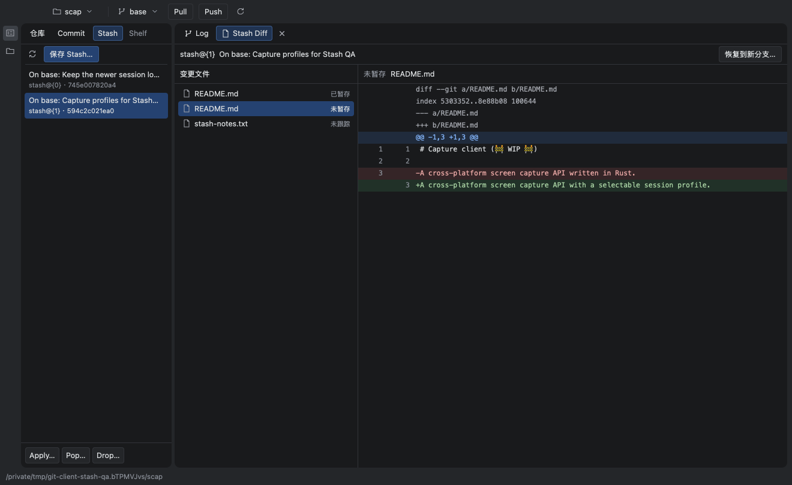

<p align="center">
  
</p>

<h1 align="center">GitHalo</h1>

<p align="center">
  <strong>基于 Rust + GPUI 构建的原生高性能桌面 Git 客户端</strong><br />
  将 JetBrains 级完整 Git 工作流与多仓分组实时同步看板融于一体，彻底告别 JVM 与 Electron 的资源开销。
</p>

<p align="center">
  <a href="README.md">English</a> · <strong>简体中文</strong>
</p>

<p align="center">
  
  
  
  
  
</p>

---

<p align="center">
  
</p>

## 为什么做 GitHalo？

现代研发很少只守着单个仓库——微服务拆分、前后端联调、公共组件库，再加上多个并行开发的 `git worktree`，挑一款趁手的桌面 Git 工具常常要面临尴尬的取舍：

- **JVM / Electron 客户端**：功能丰富，但动辄占用数百 MiB 到数 GiB 内存，冷启动慢，多仓来回切换容易卡顿。
- **轻量开源 GUI**：轻便易用，但在真正需要交互式 Rebase、内置三方冲突编辑器、按变更块局部提交或独立 Shelf 搁置时力不从心。
- **高性能原生客户端**：体验顺滑，但大多闭源且需要付费订阅。

**GitHalo** 希望给出一个干净的解法：以 **Rust + GPUI**（[Zed](https://github.com/zed-industries/zed) 同源 GPU 渲染引擎）从零原生编写、完全开源免费，把**多仓业务分组同步驾驶舱**、**完整专业级 Git 工作流**与 **100% 本机 Git CLI 兼容性**合而为一。

### 核心能力一览

| 维度 | GitHalo | Rebased / IntelliJ Git | GitKraken | Fork / Sublime Merge | GitHub Desktop |
| --- | :---: | :---: | :---: | :---: | :---: |
| **开源免费** | Apache-2.0 | Apache-2.0 | 闭源付费 | 闭源付费 | MIT |
| **底层引擎** | **Rust + GPUI (GPU 加速)** | JVM | Electron | 原生 / C++ | Electron |
| **多仓业务分组与实时同步看板 (`↓ / ↑`)** | **原生内置** | 单项目视角 | 仅收藏夹 | 仅标签页 | 单仓切换 |
| **Git Worktrees 一等管理** | **完整支持** | 完整支持 | 有限支持 | 有限支持 | 不支持 |
| **按块暂存与局部提交 (Hunk Commit)** | **完整支持** | 完整支持 | 付费版 | 完整支持 | 按行暂存 |
| **交互式 Rebase & 内置三方解冲突** | **完整支持** | 完整支持 | 付费版 | 完整支持 | 不支持 |
| **独立 Shelf 补丁搁置（不污染 Stash）** | **完整支持** | 完整支持 | 不支持 | 不支持 | 不支持 |
| **左右分栏并排 Diff + 词级行内高亮** | **完整支持** | 完整支持 | 支持 | 支持 | 基础对比 |
| **本机 Git 兼容（Hooks / SSH / GPG）** | **100% 原生** | 原生 | libgit2 | 原生 | 原生 |
| **原生中 / 英双语** | **自动跟随系统** | 需插件 | 仅英文 | 仅英文 | 仅英文 |

---

## 核心亮点

### 1. 多仓业务分组总览 & Git Worktree 一等公民
- **按业务自定义分组**：将本地工作树归入不同业务组（同一工作树可加入多个分组并共享实时状态）。即使折叠分组，组头依然清晰汇总（如 `商城 · 3 个仓库 · 2 个有差异 · 1 个待确认`）。
- **无需点开详情即可洞察同步状态**：每行直接展示当前分支与相对配置上游 `@{upstream}` 的精准 `↓ 落后 / ↑ 领先` 提交数，同时清晰区分分离 `HEAD`、空分支、未配置上游、上游已删除、认证失败及失效路径等异常状态。
- **并发可控、故障隔离的后台 Fetch**：支持单仓刷新与整组一键刷新，自动合并重复请求并限制并发；某个仓库断网、HTTP 401 或路径失效时，不影响其他健康仓库继续刷新，并支持逐行单独重试。
- **严格的异步状态归属校验**：每个后台读写任务均绑定发起时的工作树、分支与上游快照。刷新期间切仓或在终端切分支，迟到结果绝不会串仓或污染当前草稿与刷新时间。
- **原生 Git Worktrees 管理**：顶栏直接管理关联工作树——支持列表查看、新建工作树（可同时建新分支并自动登记）、锁定/解锁、移除（保护主工作树）及 Prune 清理；关联工作树各自独立显示状态，并在共享远端引用更新后自动重算。

### 2. 完整的专业级 Git 工作流
- **精准暂存与局部提交**：已暂存 / 未暂存双区视图（同一文件可同时出现在两侧并各自查看 Diff），支持按文件或勾选文本变更块（Hunk）暂存、取消暂存及**仅提交所选变更块**（其余已暂存和未暂存内容完好保留）；支持 Amend 自动预填修订、单文件安全 Rollback 及「提交并推送」组合流。
- **可视化交互式 Rebase 与中断恢复**：支持标准 Rebase（含 `--autostash`）与可视化交互式 Rebase（上下调序、切换 `Pick / Reword / Squash / Fixup / Drop` 与自定义提交说明）；冲突中断后展示进度横幅，重启应用后仍可无缝 `Continue / Skip / Abort`。
- **内置三方冲突解决器**：按操作语义（Merge / Rebase / Cherry-pick / Revert）清晰标注 `Base / Yours / Theirs`，支持一键采用本地、采用传入、保留双方，或使用内置多行合并编辑器手动编辑后直接保存暂存。
- **Merge、Cherry-pick、Reset 与 Revert**：合并支持快进 / `--no-ff` / `--ff-only` / `--squash`；Cherry-pick 支持 `-x` 与合并提交 `-m`；支持 Undo Commit（`--soft HEAD^`）、Reset（`Soft / Mixed / Hard / Keep`）与 Revert（含冲突恢复）。
- **双保险搁置体系：Stash + 独立 Shelf**：
  - **Stash**：按已暂存、未暂存、未跟踪三层分别预览逐文件 Diff，支持 Apply、Pop、单条 Drop 以及从原基点恢复到新分支。
  - **Shelf**：独立补丁存储于 `<git-common-dir>/githalo-shelf/`，完全不触碰 `refs/stash`；支持按文件选择性搁置、Diff 预览、Unshelve（保留或移出）及删除。
- **远端、分支与标签全管理**：Clone、Init、Remotes 管理、分支上游跟踪绑定/解除、轻量与附注标签的创建/推送/删除；Pull 支持三段策略切换（`--ff-only` / `Merge` / `Rebase --autostash`）；Push 支持 `--force-with-lease` 安全强推与日志右键「推送至此提交」。

### 3. 代码审阅级 Diff 与深度历史检索
- **左右分栏并排 Diff + 词级行内高亮**：提交 Diff、工作区 Diff、Stash Diff、Shelf Diff 全链路支持实时切换「并排 / 统一」视图；双击任意变更文件即可在主区展开全宽「提交 Diff」标签页，配合 `← / →` 连续审阅。
- **结构化历史筛选**：提交图展示彩色分支 / HEAD / 远端 / 标签胶囊徽章，支持关键词与 `author:`、`branch:`、`after:`、`before:` 组合筛选，并支持突破初始 200 条按需加载更多历史。
- **单文件历史、逐行 Blame 与任意修订比较**：在 Diff 顶部一键打开「历史 / Blame」双页签弹窗；在提交图右键可将任意提交设为比较基准，跨版本比对文件差异。
- **随仓联动的项目文件树**：左栏可一键切至当前工作树的磁盘目录按需展开浏览，返回仓库列表后完整保留分组展开与选中态。

### 4. 为速度、安全感与真实开发环境而生
- **100% 直接驱动本机 Git CLI**：不依赖 `libgit2` 重写协议层，天然完美兼容你本机的 SSH Agent、GPG 签名、Git Hooks（`pre-commit` / `pre-push` 等）、`.gitconfig` `includeIf` 与凭据管理器。
- **显式确认与防误操作**：提交、推送（明确区分 Fork 推送目标与上游分支）、安全强推、Hard Reset、中止合并/变基等操作均带清晰确认预览，标明实际作用的工作树、分支、目标与文件范围。
- **原生中 / 英双语**：默认自动识别系统语言，也可在偏好设置中随时切换或通过 `GITHALO_LANG=en|zh` 临时指定。

---

## 界面实机预览

<table>
  <tr>
    <td width="50%">
      <strong>按变更块暂存与局部提交</strong><br />
      同文件内按 Hunk 精准勾选暂存或局部提交，未选改动互不干扰。
      
    </td>
    <td width="50%">
      <strong>三层 Stash 预览与安全恢复</strong><br />
      分别查看已暂存、未暂存和未跟踪文件 Diff，支持 Apply / Pop / 恢复到新分支。
      
    </td>
  </tr>
</table>

---

## 性能表现

GitHalo 采用可见区虚拟化渲染（已验证 10,000 文件级变更树范围索引）与 Diff 解析缓存，在大仓与多仓切换下依然保持低占用与高响应。

### 实测样本（macOS Apple Silicon）

- **极致轻量体积**：压缩后的 macOS `.dmg` 安装包仅 **6.6 MiB**（原生 Mach-O arm64 单可执行文件 **15 MiB**），无需打包 Electron 或 JVM 运行时。
- **原生窗口（Debug 开发构建）**：首帧可交互 **232–402 ms**，稳态内存 RSS **68.7–69.4 MiB**。
- **8 仓库分组工作区（Release 数据层基准，热缓存，3 轮中位数）**：
  - 重开恢复 SQLite 登记与分组：**3.1 ms**
  - 展开组至全部 8 仓本地 `↓ / ↑` 计数就绪：**463.7 ms**
  - 切仓至首个文本 Diff 解析就绪：**184.0 ms**
  - 整组 8 仓后台并发 Fetch 完成：**860.2 ms**

> 实测环境为 Apple Silicon macOS、本机 Git 2.50.1 及内置离线测试夹具（`client/src/git/fixtures/sync.bundle`）。

可在本地一键复跑性能基准：

```bash
cd client
cargo test --release --locked --no-default-features --test workspace_flow first_release_timings -- --ignored --nocapture
```

---

## 高频快捷键

| 快捷键（macOS / Linux & Win） | 功能 |
| --- | --- |
| `Cmd+K` / `Ctrl+K` | 打开 Commit 提交页 |
| `Cmd+Shift+K` / `Ctrl+Shift+K` | 打开 Push 推送确认 |
| `Cmd+T` / `Ctrl+T` | 打开 Pull 拉取弹窗 |
| `Cmd+L` / `Ctrl+L` | 聚焦提交历史搜索与筛选栏 |
| `←` / `→` | 在全宽「提交 Diff」标签页切换上一/下一变更文件 |

---

## 安装与快速开始

### 环境要求

- **Git 2.43+**（需要 `git fetch --porcelain`、`git show-ref --exists` 及局部块提交使用的 `git merge-file --object-id`）
- **Rust**（支持 Rust 2024 edition 的 stable 工具链）
- **macOS**：Xcode Command Line Tools（使用系统字体与运行时编译的 Metal 着色器）

### 下载预编译安装包（macOS）

直接前往 **[GitHub Releases](https://github.com/chobitsX/githalo/releases/latest)** 下载最新版 macOS Apple Silicon `.dmg` 安装包（仅约 6.6 MiB），将 **GitHalo.app** 拖入 `/Applications` 即可使用。

> **macOS 首次启动提示**：开源初版暂未接入 Apple 公证签名，若系统提示无法打开，可在终端执行一次：
> ```bash
> xattr -dr com.apple.quarantine /Applications/GitHalo.app
> ```

### 从源码构建运行

```bash
git clone https://github.com/chobitsX/githalo.git
cd githalo

# 构建并启动 Release 优化版本
cargo run --release --manifest-path client/Cargo.toml --locked
```

常用运行环境变量：

```bash
# 临时指定界面语言（"en" 或 "zh"）
GITHALO_LANG=en ./client/target/release/githalo

# 使用独立的 SQLite 工作区数据库（适合体验或隔离测试）
GITHALO_DB=/tmp/githalo-demo.sqlite3 ./client/target/release/githalo
```

仓库登记、分组与 Fetch 记录保存在本地数据目录：
- **macOS**：`~/Library/Application Support/githalo/workspace.sqlite3`
- 视图与语言偏好保存在同目录的 `preferences.ini`。

---

## 平台支持与路线图

| 平台 | 当前状态 | 说明 |
| --- | --- | --- |
| **macOS (Apple Silicon)** | 已实机验证 | 完整桌面交互与 145 项自动化回归全部通过 |
| **macOS (Intel)** | 实验性支持 | 复用 GPUI Metal 后端，欢迎社区实测反馈 |
| **Linux (Wayland / X11)** | 实验性支持 | 数据层已接入 CI，`gpui_platform` 已开启 Wayland/X11，欢迎 PR |
| **Windows** | 规划中 | GPUI Windows 后端适配与打包，欢迎参与贡献 |

**后续规划：**
- Diff 与 Blame 视图语法高亮
- 浅色主题与自定义配色方案
- Git Submodules 与 Git LFS 专项工作流
- macOS Intel / Linux / Windows 预编译安装包与 Homebrew Cask 分发

---

## 参与贡献

非常欢迎提交 Issue 和 Pull Request！开发环境配置、架构模块说明与验证命令请参考 [CONTRIBUTING.md](CONTRIBUTING.md)。

```bash
cd client
cargo fmt --all -- --check
cargo clippy --locked --all-targets -- -D warnings
cargo test --locked
```

---

## 致谢

- **[Zed Industries / GPUI](https://github.com/zed-industries/zed)**：提供高性能 Rust GPU 桌面渲染框架（`Apache-2.0`）。
- **[Rebased](https://github.com/DetachHead/rebased)**（`1.1.24`）：作为 Git 交互与工作流的参考基线，启发了 GitHalo 的 Rust 独立实现。
- **[Scap](https://github.com/zed-industries/scap)**：离线测试夹具所用的公开 Git 历史来源（`MIT`）。

完整第三方许可与归属声明见 [NOTICE](NOTICE)。

## 开源协议

GitHalo 基于 [Apache License 2.0](LICENSE) 协议开源。
